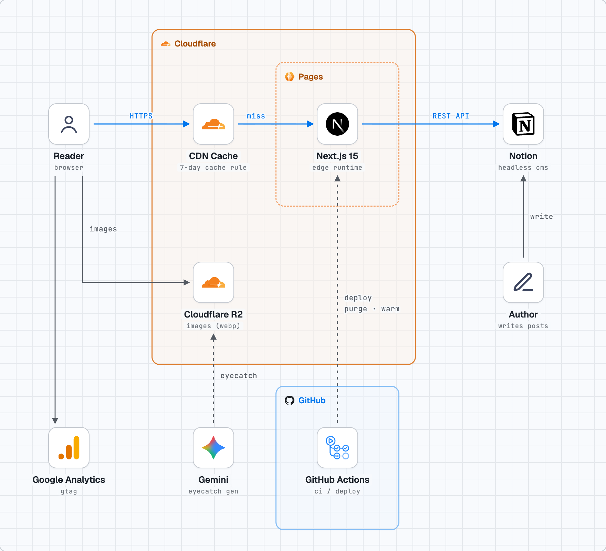

# kt-tech.blog

Notion で書いた記事を、Next.js 15 (Edge Runtime) + Cloudflare Pages で配信している技術ブログ。

**https://kt-tech.blog**

<picture>
  <source media="(prefers-color-scheme: dark)" srcset="docs/architecture-dark.png">
  
</picture>

## 仕組み

| 流れ | 内容 |
|---|---|
| 配信 | 読者のリクエストはまず Cloudflare の CDN に届く。Cache Rule で `/blogs/` `/categories/` `/tags/` `/archives/` を 7 日間キャッシュしており、HIT 時の TTFB は約 0.06 秒 |
| 描画 | キャッシュミス時だけ Cloudflare Pages の Worker (Next.js 15, Edge Runtime) が Notion REST API を叩いてページを組み立てる |
| 執筆 | 記事は Notion のデータベースに書く。`Status` が `Published` のものだけ公開される |
| 画像 | アイキャッチは Gemini で生成 → WebP に変換 → Cloudflare R2 に置いて直接配信。Notion にアップロードした本文画像は署名 URL が 1 時間で切れるので、`/api/notion-image/[blockId]` 経由で都度取り直す |
| デプロイ | `main` への push で GitHub Actions がビルド → デプロイ → CDN 全パージ → 全記事ウォームまで行う |

## 技術スタック

| レイヤー | 技術 |
|---|---|
| フレームワーク | Next.js 15 (App Router, Edge Runtime) |
| 言語 / UI | TypeScript, React 19, Tailwind CSS, shadcn/ui |
| CMS | Notion REST API（`libs/notion.ts` で直接 `fetch`。SDK は crypto 依存で Edge では動かない） |
| 本文レンダリング | markdown-it, highlight.js, KaTeX, Mermaid |
| ホスティング | Cloudflare Pages (`@cloudflare/next-on-pages`) |
| CDN | Cloudflare CDN + Cache Rule（7 日 TTL） |
| 画像 | Cloudflare R2 (WebP), Gemini（アイキャッチ生成） |
| CI/CD | GitHub Actions |
| 分析 | Google Analytics |
| OGP | `next/og` で記事ごとに動的生成 |

## 主な機能

**記事**
- Notion ブロックを Markdown 経由で HTML に変換（書き方の対応表は [claude.md](claude.md#本文の書き方notion-ブロックの扱い)）
- コードブロック: ファイル名、行ハイライト、diff 表示、Copy ボタン、ライト/ダーク対応のハイライト
- Callout、脚注、数式 (KaTeX)、Mermaid、YouTube などの埋め込み、リンクカード
- 目次、読了プログレスバー、前後の記事、関連記事、シリーズ（連載）ナビゲーション
- 「この記事でわかること」・対象読者・更新履歴の表示（Notion のプロパティから）

**サイト**
- カテゴリ / タグ / アーカイブ / シリーズ一覧、全文検索（ハイライト付き）
- ブックマーク・読書統計（ブラウザのローカルに保存）
- ライト/ダークモード、スケルトンローディング、画像 lightbox

**配信・SEO**
- RSS (`/feed.xml`)、サイトマップ (`sitemap.ts`)、`robots.ts`
- 記事タイトル入りの OGP 画像を動的生成
- AI 検索向けの `llms.txt`、PWA (`manifest.json`)

## 開発

Node.js 22 を使う（CI と同じ）。

```bash
npm install --legacy-peer-deps
# .env.local を作る（下の「環境変数」を参照）
npm run dev                        # → http://localhost:3000
```

### 本番と同じ状態で確認する

```bash
npm run preview   # → http://localhost:8788
```

**`npm run start` は本番の再現にならない。** `next start` は Node.js サーバーとして動くが、
本番は Cloudflare Pages（`@cloudflare/next-on-pages` が生成する Worker）で動いており、
CSS のバンドル結果もページごとの読み込みも別物になる。実際 `next start` では

- 記事ページに layout の CSS が読み込まれず、`--font-noto-sans-jp` が未定義になる
- ソースを変えてビルドし直しても、古い出力を返し続けることがある

といった食い違いが出る。フォントや画像 URL のように「本番でどう配信されるか」が
問われる変更は、必ず `npm run preview` で確認すること。

`preview` は次の3つをまとめて実行する。

| | 内容 |
|---|---|
| `preview:env` | `.env.local` → `.dev.vars` を同期。wrangler は `.env.local` を読まないので、無いと全ページ 503 |
| `pages:build` | `@cloudflare/next-on-pages` で本番と同じビルド |
| `preview:serve` | `wrangler pages dev`。`nodejs_compat` フラグが無いと Worker が起動せず 503 |

### コマンド

| コマンド | 内容 |
|---|---|
| `npm run dev` | 開発サーバー |
| `npm run lint` | ESLint |
| `npm run preview` | 本番と同じビルドをローカルで起動 |
| `npm run pages:build` | Cloudflare Pages 用ビルド |
| `node scripts/generate-eyecatch.mjs` | アイキャッチ未設定の記事に画像を生成（`--dry-run` で対象確認のみ） |
| `node scripts/lint-content.mjs` | Notion の記事を品質チェック |

## デプロイ

`main` に push（マージ）すると [`deploy.yml`](.github/workflows/deploy.yml) が走る。手動なら:

```bash
gh workflow run deploy.yml
```

1. `@cloudflare/next-on-pages` でビルド
2. `wrangler pages deploy` で Cloudflare Pages にデプロイ
3. CDN キャッシュを全パージ
4. トップ・一覧・公開中の全記事を叩いてキャッシュをウォーム
5. 検索エンジンにサイトマップを通知

PR では [`pr-check.yml`](.github/workflows/pr-check.yml) が lint とビルドを確認する。

> [!NOTE]
> CDN が 7 日キャッシュするので、Notion での編集はデプロイ（パージ → ウォーム）するまで反映されない。
> ただし Worker 側にも記事キャッシュ（本文 15 分）があり、編集直後にデプロイすると古い本文でウォームされて CDN に載り直す。
> 最後の編集から 15 分以上空けてからデプロイすること。

## 環境変数

`.env.local`（Cloudflare Pages の Settings と GitHub Secrets にも同じものを設定する）:

```env
NOTION_API_KEY=          # Notion インテグレーションのトークン
NOTION_DATABASE_ID=      # 記事データベースの ID
NEXT_PUBLIC_GA_ID=       # Google Analytics
SITE_URL=https://kt-tech.blog
```

<details>
<summary>CI 用・アイキャッチ生成用</summary>

GitHub Secrets のみ:

```env
CLOUDFLARE_API_TOKEN=
CLOUDFLARE_ACCOUNT_ID=
CLOUDFLARE_ZONE_ID=      # キャッシュパージ用
```

アイキャッチ生成スクリプト用（`.env.local` のみ）:

```env
GEMINI_API_KEY=
R2_ENDPOINT=
R2_ACCESS_KEY=
R2_SECRET_KEY=
NEXT_PUBLIC_BUCKET_NAME=
NEXT_PUBLIC_R2_BUCKET_URL=
```

</details>

## Notion データベース

`Title` と `Status` 以外は空でも表示できる。プロパティの一覧と本文の書き方は [claude.md](claude.md#notion-のデータベースプロパティ) にまとめてある。

## ディレクトリ構成

```
src/app/           App Router（記事・一覧・検索・OGP・RSS・sitemap）
src/components/    UI コンポーネント
libs/              Notion REST API クライアント（notion.ts）と記事キャッシュ（notionCache.ts）
styles/            記事本文とコードハイライトの CSS
scripts/           アイキャッチ生成、コンテンツ lint、preview 用の補助
docs/              構成図（architecture.html が元データ）
.github/workflows/ デプロイと PR チェック
public/            静的ファイル、manifest.json、llms.txt
```

## 開発時の制約

- 動的ルートには必ず `export const runtime = 'edge'` を付ける
- Edge Runtime なので ISR (`revalidate`) と `generateStaticParams` は使えない
- Node.js 専用 API（`fs`, `path`, `crypto` など）は使えない
- 外部画像のドメインは `next.config.js` の `remotePatterns` に追加する

詳しくは [claude.md](claude.md) を参照。

## 構成図の更新

`docs/architecture.html` をブラウザで開き、`.canvas` 要素をライト / ダーク（`<html data-theme="dark">`）それぞれでスクリーンショットして `docs/architecture.png` / `docs/architecture-dark.png` を差し替える。図のスタイルは [stack-diagram](https://github.com/caru-ini/stack-diagram) のテンプレートを使っている。

## Author

**Koki** — [@tech_koki](https://x.com/tech_koki) / [GitHub](https://github.com/j19015)
